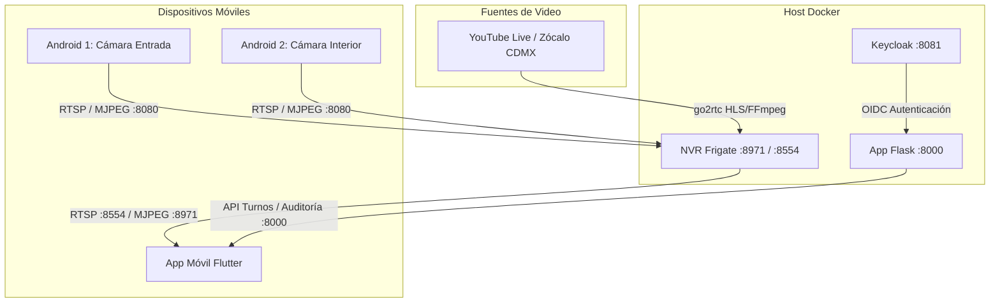

# Guía de NVR Frigate, Cámaras Android & App Móvil Flutter

Este documento detalla la integración centralizada del sistema NVR **Frigate** dentro del proyecto **Identity Access Lab MVP**, junto con la conexión de teléfonos Android como cámaras IP, la cámara en vivo de prueba (Zócalo CDMX) y la integración con la aplicación móvil en **Flutter**.

---

## 1. Arquitectura Centralizada

El archivo maestro [`compose.yaml`](../compose.yaml) agrupa todos los servicios en un único entorno:



### Puertos Publicados en el Host
- **`8000`**: Aplicación Web del Laboratorio y Bitácora (`/` y `/turno`).
- **`8081`**: Servidor de Identidad Keycloak.
- **`8971`**: Panel Web de Frigate NVR y API REST / MJPEG.
- **`8554`**: Retransmisión RTSP ultrarrápida go2rtc (para la app Flutter y VLC).
- **`8555`**: WebRTC (TCP/UDP) para baja latencia en navegadores.

---

## 2. Puesta en Marcha Rápida

1. **Configurar el archivo `.env`:**
   ```bash
   cp .env.example .env
   ```
   *(Ajusta contraseñas y las IPs de las cámaras si ya las conoces)*.

2. **Levantar todos los servicios centralizados:**
   ```bash
   docker compose up -d
   ```

3. **Verificar estado de los contenedores:**
   ```bash
   docker compose ps
   ```

4. **Acceder a las interfaces:**
   - **Aplicación Web & Relevos:** <http://localhost:8000/turno>
   - **Panel NVR Frigate:** <http://localhost:8971>
   - **Keycloak:** <http://localhost:8081>

---

## 3. Cámara en Vivo de Prueba (Zócalo CDMX / YouTube Live)

Para que el NVR funcione inmediatamente sin esperar a tener los teléfonos físicos conectados, se incluye una cámara demostrativa configurada en `frigate/config/config.yml`:

```yaml
go2rtc:
  streams:
    zocalo_cdmx:
      # Stream HLS de prueba 24/7 de alta estabilidad
      - "ffmpeg:https://test-streams.mux.dev/x36xhzz/x36xhzz.m3u8#video=copy#audio=aac"
```

### ¿Cómo transmitir directamente el canal de YouTube Live de Webcams de México?
Las URLs de YouTube Live (`https://www.youtube.com/@webcamsdemexico/live`) no entregan un archivo de video crudo, sino un reproductor web con tokens rotativos. Para consumir YouTube en Frigate:

1. **Opción con `yt-dlp` en el host:**
   Ejecuta:
   ```bash
   yt-dlp -g https://www.youtube.com/@webcamsdemexico/live
   ```
   Copia el enlace `.m3u8` resultante y colócalo en `frigate/config/config.yml` bajo `ffmpeg:<URL_RESULTANTE>#video=copy#audio=aac`.

2. **Opción automática dentro de go2rtc (si el contenedor tiene yt-dlp):**
   ```yaml
   go2rtc:
     streams:
       zocalo_cdmx:
         - "exec:yt-dlp -g https://www.youtube.com/@webcamsdemexico/live"
   ```

---

## 4. Configuración de los 2 Teléfonos Android como Cámaras

Cuando dispongas de los 2 teléfonos Android:

### Paso 1: Instalar la aplicación de cámara en cada teléfono
Descarga desde Google Play Store una de las siguientes aplicaciones gratuitas:
- **IP Webcam** (Pavel Khlebovich)
- **RTSP Camera Server** (shenyaocn)

### Paso 2: Conectar los teléfonos a la red Wi-Fi del laboratorio
Asegúrate de que la PC con Docker y los teléfonos Android estén en la misma red Wi-Fi o subred LAN.
Anota las IPs que el router les asigne (ejemplo: `192.168.1.101` para Entrada y `192.168.1.102` para Interior).

### Paso 3: Configurar usuario y contraseña en la app Android
En los ajustes de la app en Android, activa la seguridad con usuario y contraseña (por ejemplo, usuario `admin`, contraseña `admin`).

### Paso 4: Actualizar `.env` y activar las cámaras en Frigate
En tu `.env`:
```env
FRIGATE_CAM_USER=admin
FRIGATE_CAM_PASS=admin
FRIGATE_CAM_ENTRADA_IP=192.168.1.101
FRIGATE_CAM_INTERIOR_IP=192.168.1.102
FRIGATE_CAM_PORT=8080
```

En `frigate/config/config.yml`, cambia `enabled: false` a `enabled: true`:
```yaml
cameras:
  cam_entrada:
    enabled: true
  cam_interior:
    enabled: true
```

Reinicia Frigate:
```bash
docker compose restart frigate
```

---

## 5. Conexión de la Aplicación Móvil en Flutter

El código completo y listo para compilar se encuentra en [`modules/mobile_flutter/`](../modules/mobile_flutter/).

### Cómo consume video Flutter:
1. **Modo Liviano (Snapshot Polling / HTTP MJPEG):**
   - URL: `http://<IP_PC>:8971/api/zocalo_cdmx/latest.jpg`
   - La app refresca la imagen periódicamente sin requerir codecs C++ ni VLC nativo en Flutter.
2. **Modo Ultrabaja Latencia (RTSP go2rtc):**
   - URL: `rtsp://<IP_PC>:8554/zocalo_cdmx`
   - Compatible con paquetes como `media_kit` o `flutter_vlc_player`.

### Para probar la app móvil:
```bash
cd modules/mobile_flutter
flutter pub get
flutter run
```
*(Si pruebas en emulador Android, utiliza la dirección `10.0.2.2` que apunta al localhost de la máquina host).*

---

## 6. Portal de Cambio de Turno (`/turno`)

El archivo HTML proporcionado para el cambio de turno ha sido integrado formalmente en la aplicación:
- **Ruta Web:** <http://localhost:8000/turno>
- **Persistencia dual:** Guarda en `localStorage` del navegador para funcionamiento desconectado y sincroniza automáticamente con el endpoint `/api/turno` de la aplicación Flask.
- **Auditoría integrada:** Cada relevo de turno crea un evento auditado (`store.event`) visible en la Bitácora y correlacionable con Wazuh.
- **Acceso directo a Frigate:** Dispone de enlace directo al NVR en el puerto `:8971`.
